## the mess

{width="60%" fig-align="center" fig-alt="PhD Comics Desk Entropy: a workspace degenerating into clutter as entropy rises over time."}

::: {.smaller}
Workspaces tend toward entropy. **AI without specs climbs the curve faster.**
:::

::: {.tinyfoot}
Comic: Jorge Cham · phdcomics.com (Desk Entropy, 2005)
:::

::: {.notes}
~90s. Merges origin + sprawl + entropy.

- start of my PhD: a dataset from a departing postdoc, no naming convention, changing every session
- couldn't list sessions or find paired files, so I hand-built a DB manager, a batch runner, a tool that emailed me when batches finished (repo PyRatECoG, if asked)
- built a personal lab-ops stack before doing any science; every new analysis meant more
- months later I could not reorient: what is this file, which config produced it; the conventions lived only in my head
- the comic: every project trends to disorder, tidying is temporary
- the new risk: an agent is an amplifier, raising the rate at which structure or disorder accumulates; without specs it adds entropy faster than I remove it
- land it: never doing this by hand again
- then the pivot: with a well-described problem, AI's first win was discovery — it surveys for the best existing tools, so I stop reinventing; the rest of the talk is the specs that hold entropy down
- credit: Jorge Cham, phdcomics.com (Desk Entropy, 2005)
:::

---

## Data specification (BIDS)

[the folder is the specification: source → raw → derivatives]{.take}

::: {.columns}
::: {.column width="16%"}
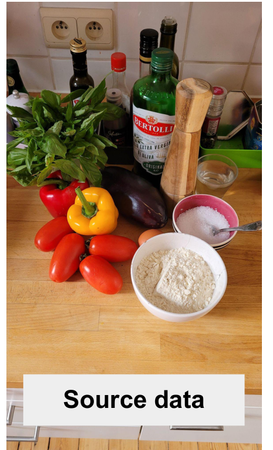{.fragment fragment-index=1 width="100%" fig-alt="Source data: raw ingredients."}
:::
::: {.column width="8%"}
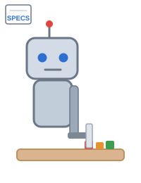{.fragment fragment-index=4 width="100%" fig-alt="A robot chopping, fed a SPECS document."}

{.fragment fragment-index=4 width="100%" fig-alt="source becomes raw"}
:::
::: {.column width="16%"}
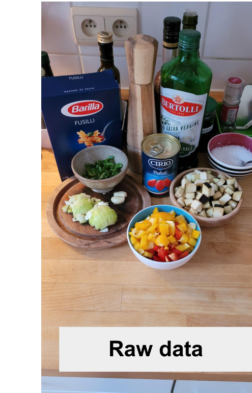{.fragment fragment-index=2 width="100%" fig-alt="Raw data: chopped and prepped."}
:::
::: {.column width="8%"}
{.fragment fragment-index=5 width="100%" fig-alt="A robot cooking, fed a SPECS document."}

{.fragment fragment-index=5 width="100%" fig-alt="raw becomes derivative"}
:::
::: {.column width="16%"}
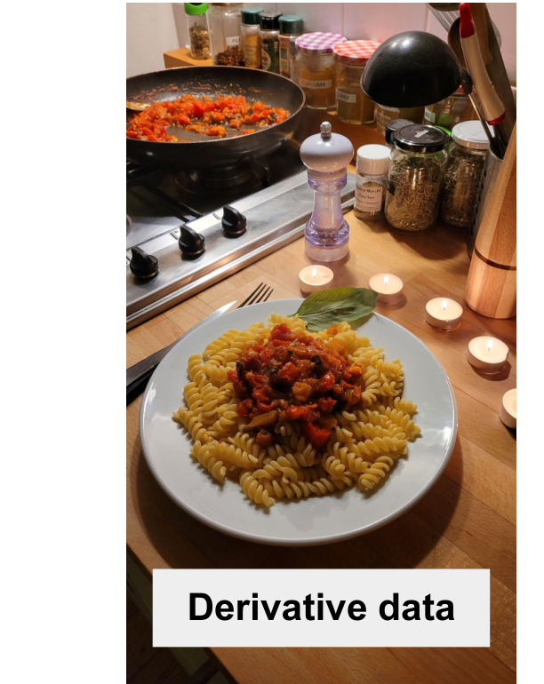{.fragment fragment-index=3 width="100%" fig-alt="Derivative data: the cooked dish."}
:::
::: {.column width="2%"}
:::
::: {.column width="32%"}
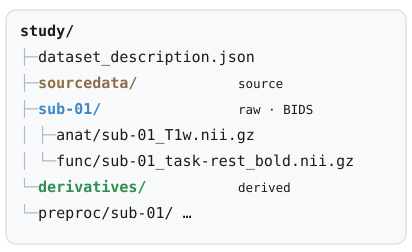{.fragment fragment-index=6 width="100%" fig-alt="An example BIDS folder tree: dataset_description.json, sourcedata (source), raw/sub-01/ses-01 with anat and func files whose names carry the sub/ses/task entities (raw, BIDS), and derivatives (derived)."}

::: {.fragment fragment-index=7 style="font-size:0.62em;line-height:1.35;margin-top:0.35em"}
**it gives us** [provenance]{style="color:#2f8f4e;font-weight:700"} (a traceable source → raw → derivatives chain) and [transparency]{style="color:#3a86c8;font-weight:700"}
:::
:::
:::

::: {.fragment .qwrap fragment-index=8}
[how can we get derivatives and results **reliably**?]{.bubble}
:::

::: {.tinyfoot}
{height="30px"} meal-prep images adapted from the BIDS Starter Kit · doi.org/10.5281/zenodo.5872274 (CC-BY)
:::

::: {.notes}
~90s. One BIDS slide; the agent transforms source → raw → derivatives.

- BIDS = community standard for how a dataset is laid out; self-describing, so I stop writing bespoke loaders
- the filename carries the metadata (subject / session / datatype); the S is for Specification, a spec makes the rules explicit, for people and agents alike
- modular: source, raw, derivatives kept apart (ingredients, mise en place, the dish); raw stays pristine, derivatives regenerable
- the real tree (right): dataset_description.json, sourcedata/, raw/sub-01/ses-01/ (anat + func, filenames carry the sub/ses/task entities), derivatives/; it gives provenance (a traceable source → raw → derivatives chain) and transparency (the filename is the metadata, the layout reads itself)
- end on the question (bubble): how do we get derivatives reliably? → next slide answers with pipelines
- images adapted from the BIDS Starter Kit (DOI 10.5281/zenodo.5872274, CC-BY)
:::

---

## Pipelines (Snakemake)

[reconstructed, and never run by hand again]{.take}

::: {.columns}
::: {.column width="30%"}
::: {.r-stack}
{width="100%" fig-alt="PhD Comics setup panel: a student thinking 'Let me do that by hand...'"}

{.fragment fragment-index=1 width="100%" fig-alt="PhD Comics full strip: the student grows frustrated doing it by hand."}
:::

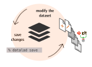{.fragment fragment-index=4 width="92%" fig-align="center" fig-alt="DataLad and git keep every version of data and code; roll back a mistake."}
:::
::: {.column width="22%"}
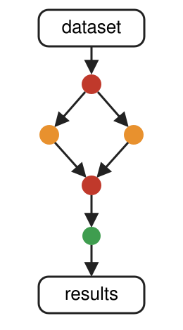{.fragment fragment-index=2 width="170" fig-align="center" fig-alt="An abstract Snakemake DAG: dataset through rule nodes to results."}
:::
::: {.column width="48%"}
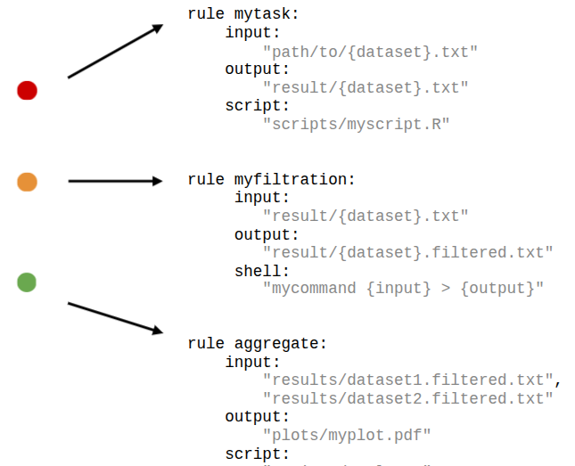{.fragment fragment-index=3 width="98%" fig-align="center" fig-alt="Each colored DAG node is a Snakemake rule with input, output, and a script or shell command."}
:::
:::

::: {.tinyfoot}
{height="30px"} {height="30px"} Snakemake · DataLad Handbook fig (CC BY-SA) · comic: Jorge Cham, phdcomics.com
:::

::: {.notes}
~2.5 min. Talk the pointers: the manual temptation (comic), then the pipeline (DAG).

- "let me do that by hand" is fine once; across a dataset it is unmaintainable
- the lived case: a chain built by several people, run order forgotten, provenance gone
- I gave the agent the final files, some intermediates, and the loose scripts; it reconstructed which script produced which file and which dependency, and numerically verified by re-running and matching the intermediates
- the colleague who wrote the scripts was surprised; a chat tab cannot do this
- then I locked it into Snakemake: rules declare input/output/params/script; it infers the DAG from filenames and reruns only what is stale
- DataLad + git version data and code; rebuilt a years-old analysis into a reproducible repo, published with the paper
- DAG/automation framing after Köster; comic Jorge Cham (phdcomics.com)
:::

---

## Exploration, grounded

[the agent, grounded in your code and your literature]{.take}

::: {.r-stack}
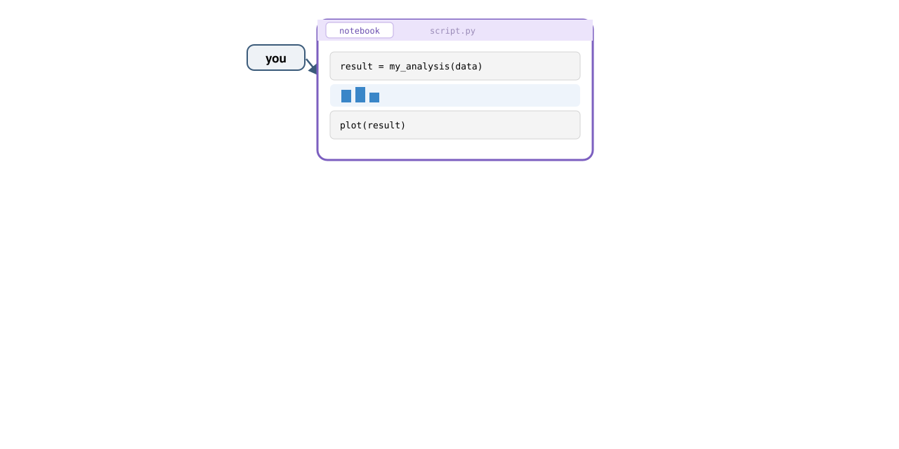{width="1120" fig-alt="Surface: a notebook or script you and the agent edit together."}

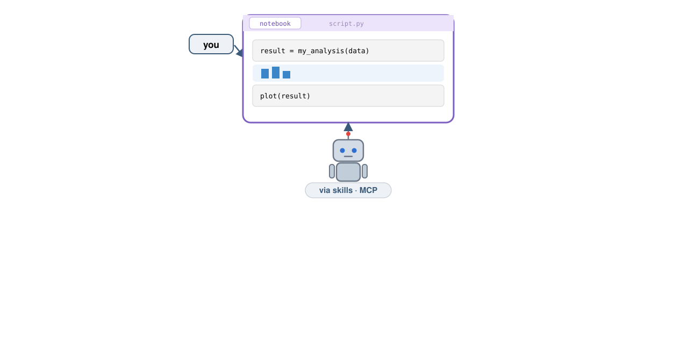{.fragment width="1120" fig-alt="The agent joins, reaching in via skills and MCP."}

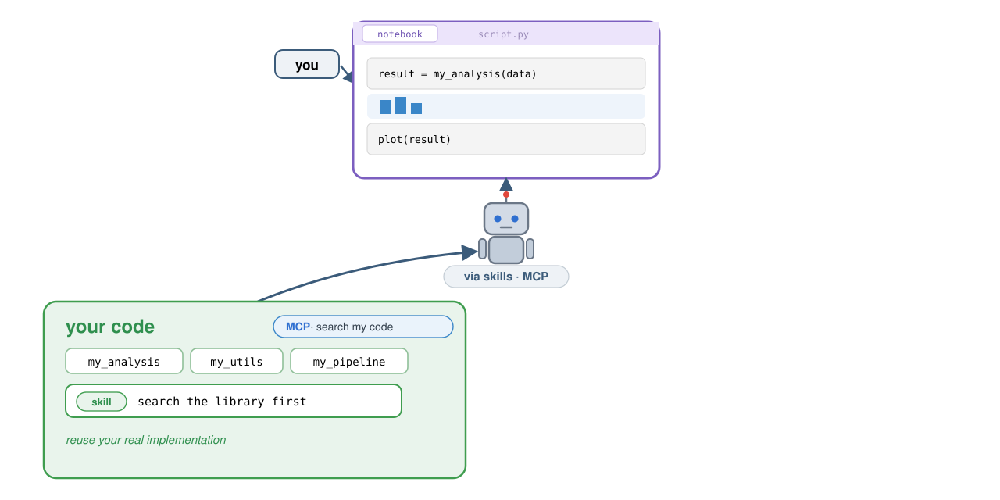{.fragment width="1120" fig-alt="Grounded in your code libraries via a search-first skill."}

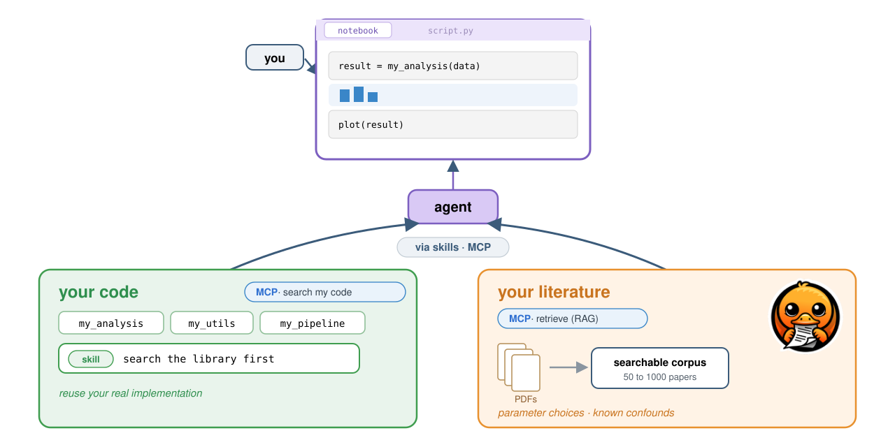{.fragment width="1120" fig-alt="Grounded also in your literature: PDFs through Docling into a searchable corpus."}

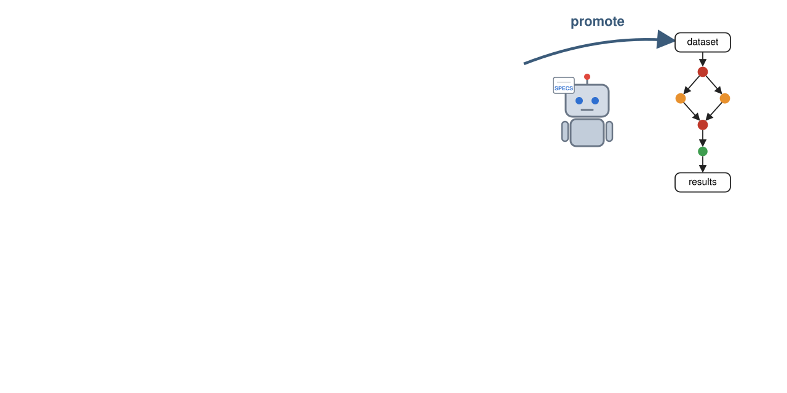{.fragment width="1120" fig-alt="Once the notebook works, the agent promotes it into a Snakemake pipeline; a promote arrow runs from the notebook to the pipeline DAG at top right."}
:::

::: {.tinyfoot}
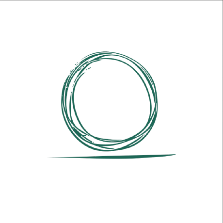{height="42px"} Marimo · marimo.io
:::

::: {.notes}
~2 min. The surface is a Marimo notebook or a Python script; the agent's help there is grounded from below.

- grounding makes reuse easier than reinvention: with your real implementation discoverable, the agent works from the code that captures the aspects you care about, rather than a naive from-scratch version
- your code, reachable via a skill (search the library first) and an MCP command, even when you have many packages and thin docs
- your literature, reachable via MCP retrieval (RAG): survey how others chose parameters, what algorithms and confounds they report, and get an organized overview; this covers your corpus, not a systematic literature review
- retrieval gives the agent evidence to reason from, and the answer still needs checking; grounded support, not free-floating guesses
- (fragment) once the notebook works, the agent promotes it into a Snakemake pipeline (the DAG from the Pipelines slide); the loop is explore here, then lock it in
:::

---

## Publication (Quarto)

[one source; every document draws from the same results]{.take}

::: {.columns}
::: {.column width="26%"}
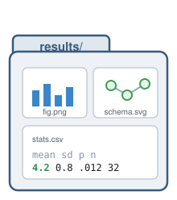{.fragment fragment-index=1 width="100%" fig-alt="A results folder holding a figure, a schematic, and a stats table (mean 4.2, sd, p, n) — the deliverables from the previous slide."}
:::
::: {.column width="7%"}
{.fragment fragment-index=2 width="100%" fig-alt="results become one source document"}
:::
::: {.column width="22%"}
{.fragment fragment-index=2 width="86%" fig-alt="A robot, fed a SPECS document, assembling the results into one source document."}

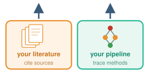{.fragment fragment-index=4 width="100%" fig-alt="Beneath the agent: your literature (to cite sources) and your pipeline (to trace methods) reach up as grounding for the write-up."}
:::
::: {.column width="7%"}
{.fragment fragment-index=3 width="100%" fig-alt="one source renders into every document"}
:::
::: {.column width="32%"}
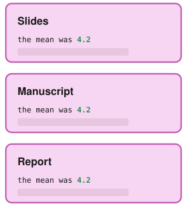{.fragment fragment-index=3 width="100%" fig-alt="Slides, manuscript, and report — each showing the same live value 4.2."}
:::
:::

::: {.tinyfoot}
{height="30px"} Quarto · quarto.org
:::

::: {.notes}
~75s. The agent takes the results from the last slide and assembles the documents.

- the previous slide left a folder of results: figures, schematics, and the numbers
- the agent, working from your SPECS, assembles them into one source document — code runs and inserts results, stats, and figures inline, no copy-paste
- that one source renders to slides, manuscript, and report; 4.2 is 4.2 everywhere, and change the data and every number updates in sync
- (fragment) the write-up is grounded too: it cites your literature and traces your pipeline, so sources and methods are documented in the output; that is the transparency
- the shift: I used to spend a long time learning each tool's details; now the agent knows them, so I bring the capabilities I need and a clear description of what I want
- pruning over-generated output is still on me (see the recap's limits box)
:::

---

## Overview

[the conventions are the rules of the game; the agent knows how to play]{.take .fragment fragment-index=8}

::: {.columns}
::: {.column width="70%"}
::: {.r-stack}
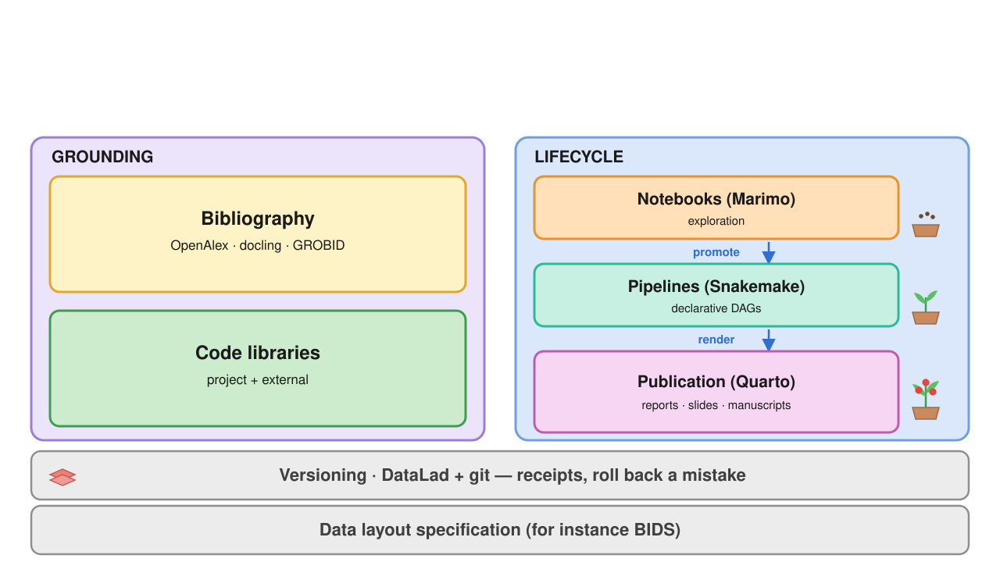{width="860" fig-alt="The stack so far, with the agent still to come."}

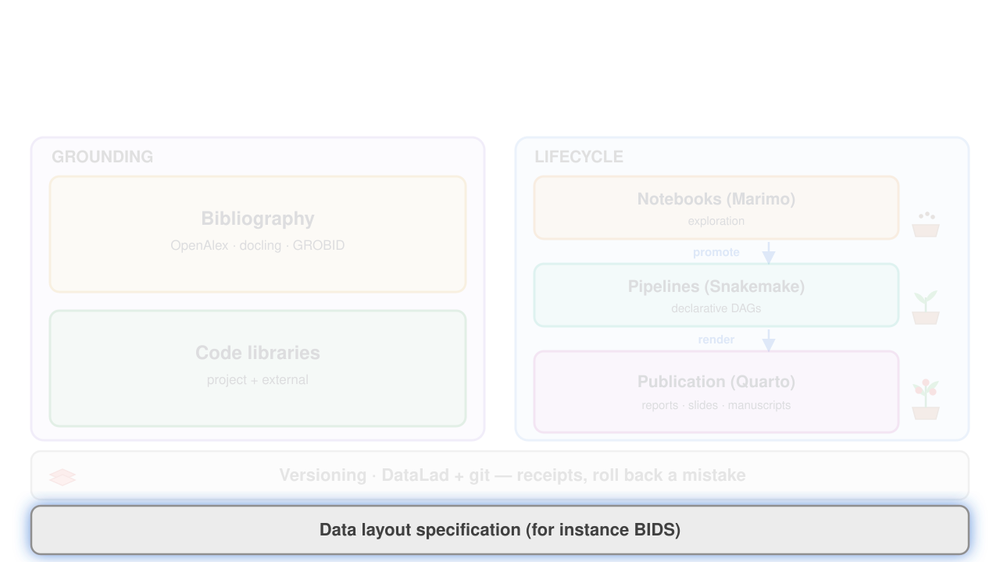{.fragment .current-visible fragment-index=1 width="860" fig-alt="BIDS data-layout spec highlighted."}

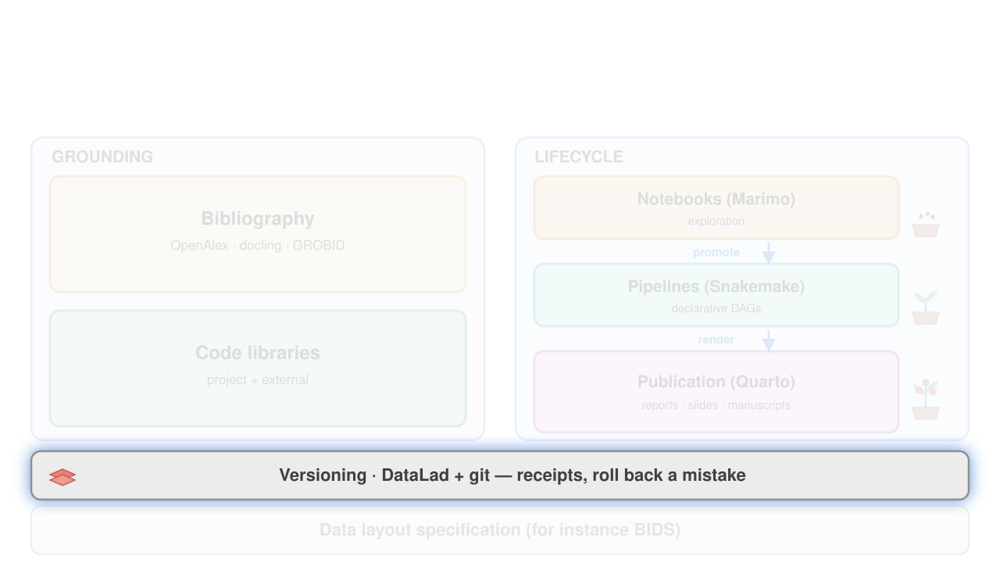{.fragment .current-visible fragment-index=2 width="860" fig-alt="DataLad and git versioning highlighted."}

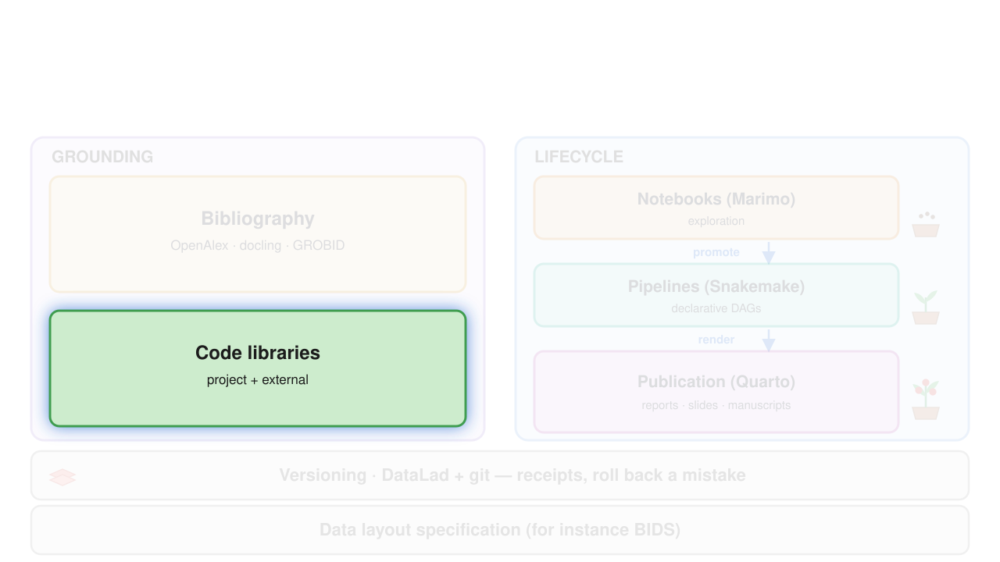{.fragment .current-visible fragment-index=3 width="860" fig-alt="Code libraries highlighted."}

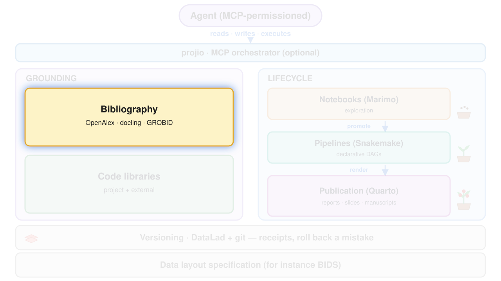{.fragment .current-visible fragment-index=4 width="860" fig-alt="Bibliography highlighted."}

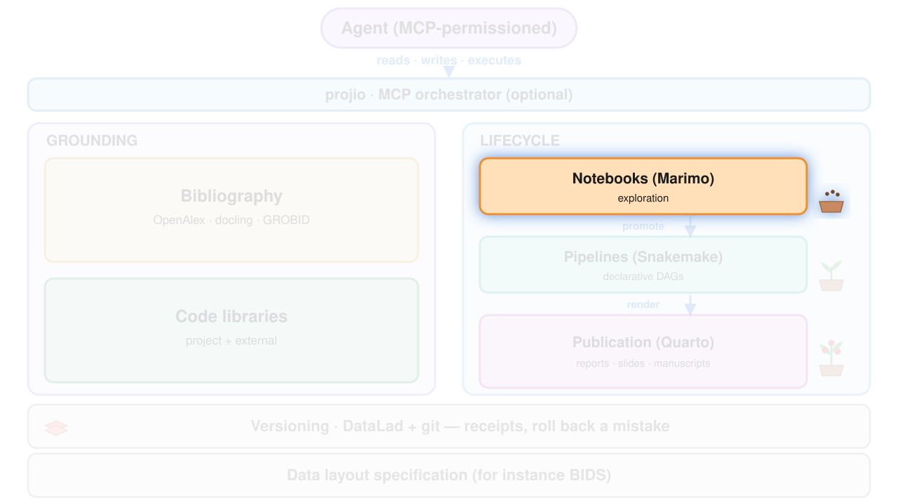{.fragment .current-visible fragment-index=5 width="860" fig-alt="Marimo notebooks highlighted."}

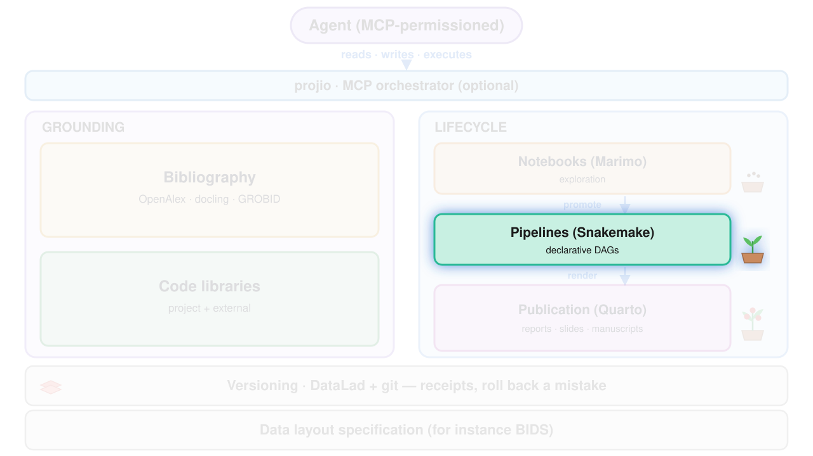{.fragment .current-visible fragment-index=6 width="860" fig-alt="Snakemake pipelines highlighted."}

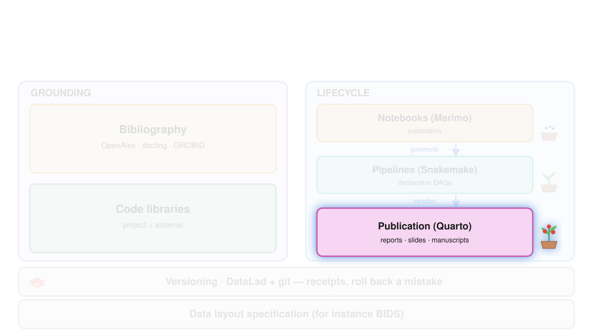{.fragment .current-visible fragment-index=7 width="860" fig-alt="Quarto publication highlighted."}

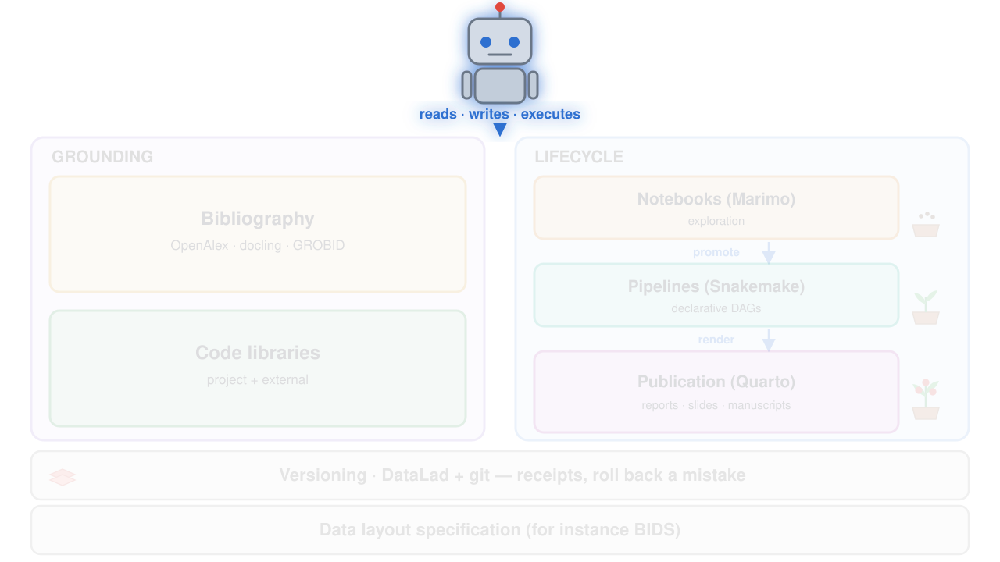{.fragment .current-visible fragment-index=8 width="860" fig-alt="The agent highlighted."}

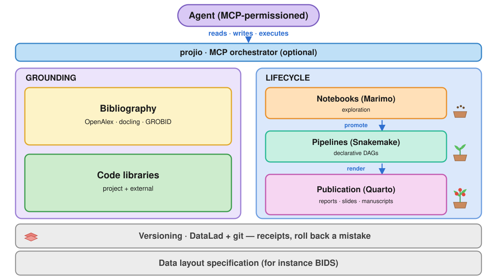{.fragment fragment-index=9 width="860" fig-alt="The whole stack lit."}
:::

::: {.fragment .smaller fragment-index=10 style="text-align:center;margin-top:0.35em"}
[reproducible]{style="color:#2bb996;font-weight:700"} · [adaptable]{style="color:#e8912e;font-weight:700"} · [transparent]{style="color:#3a86c8;font-weight:700"} 
[human remains responsible for judgment and validation]{style="font-size:0.8em;color:#55606b"}
:::
:::
::: {.column width="30%"}

::: {.fragment fragment-index=12}

4-day agentic workshop

::: {style="font-size:0.58em;color:#55606b;margin:0.15em 0 0.55em;line-height:1.4"}
Oct 2026 · [A.Shahidi@bio.lmu.de](mailto:A.Shahidi@bio.lmu.de)
:::

{style="width:100%;max-width:320px" fig-alt="QR code linking to the workshop"}
:::

::: {.fragment .limits fragment-index=11}
**still brittle:**

agents produce structure faster than I can maintain it. context retrieval still needs human checking
:::

:::
:::

::: {.notes}
~2.5 min. Combined finale: walk the stack (each click lights one, dims the rest); the agent (robot) stays hidden until the last spotlight, where it appears together with the closing line "the agent knows how to play"; then the whole stack lights; then the right panel builds: sustainable science, the honest limits, the workshop.

- every hand-built thing from slide 1 now has an agent-legible standard: BIDS · DataLad+git · code · bibliography · Marimo · Snakemake · Quarto · the agent on top
- the payoff: reproducible, adaptable, transparent; sustainable science that outlives the project and the person (framing after Köster)
- still brittle: agents produce structure faster than I can maintain it; context retrieval still needs human checking (the researcher stays in charge of the research)
- the value is in the conventions, which outlive any one tool
- workshop: 4 days, 5–8 Oct 2026, LMU Martinsried; scan the QR or email me
:::
